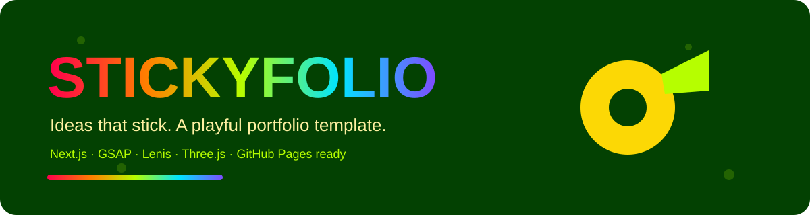
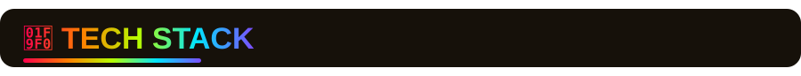
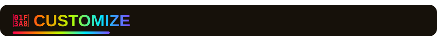
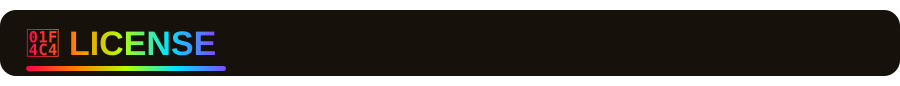

<div align="center">



<br />
<br />

<a href="#-quick-start"></a>
<a href="#-deploy-to-github-pages"></a>
<a href="PUBLISH_GUIDE.md"></a>
<a href="#-license"></a>

<br />
<br />


<br />
<br />

**A playful, tape-inspired portfolio template for designers, creative developers and studios.**  
Handmade feel, smooth motion, bold colour, and a static export that is ready for GitHub Pages.

<br />


</div>

<br />


### ✨ What makes it stick?

| Feature                        | Description                                                                 |
| ------------------------------ | --------------------------------------------------------------------------- |
| 🎬 **Cinematic preloader**     | Tape-roll loading scene with percentage counter and smooth exit.            |
| 🖱️ **Custom cursor**           | Magnetic dot + trailing tape strip, with hover labels on buttons and links. |
| 🧲 **Magnetic buttons**        | Buttons gently follow the pointer for a tactile, handcrafted feel.          |
| 🌀 **Lenis smooth scroll**     | Buttery scroll behaviour wired into GSAP ScrollTrigger.                     |
| 🎞️ **Scroll-driven scenes**    | Hero parallax, pinned horizontal work gallery, reveals and progress bars.   |
| 🧻 **Interactive skill rolls** | Clickable tape-roll tabs that update copy and recolour the 3D object.       |
| 🧊 **Three.js tape roll**      | Lightweight WebGL accent, lazy-loaded and cleaned up properly.              |
| 🔊 **Optional tape sounds**    | Tiny Web Audio “tape rip” clicks, off by default.                           |
| 📱 **Fully responsive**        | Mobile menu, touch-friendly gallery, reduced-motion support.                |
| ♿ **Accessible touches**      | Skip link, semantic sections, ARIA labels, keyboard-friendly controls.      |
| 🚀 **Static export**           | `next build` produces a plain static site for GitHub Pages.                 |
| 🌈 **Animated README**         | Rainbow SVG banner, section headers and dividers.                           |

<br />



### 🧰 Built with the good stuff

```txt
Next.js 15 App Router      → structure, routing, static export
React 19                   → components and state
GSAP + ScrollTrigger       → animation choreography
Lenis                      → smooth scrolling
Three.js                   → playful WebGL tape roll
next/font                  → self-hosted Google Fonts
Web Audio API              → optional tape sound effects
GitHub Pages / Actions     → publishing
```

> This is an **original template** inspired by tactile, craft-table web aesthetics.  
> It does not copy any third-party website’s protected assets, copy, or code.

<br />


### 🚀 Run it locally

> Requirements: **Node.js 18.18+** (Node 20 recommended) and npm.

```bash
# 1. Install dependencies
npm install

# 2. Start the dev server
npm run dev
```



### 🎨 Make it yours

| What to change                 | Where                                 |
| ------------------------------ | ------------------------------------- |
| Projects, skills, process copy | `lib/data.js`                         |
| Images                         | `public/assets/`                      |
| Brand colours                  | `app/globals.css` (`:root` variables) |
| Fonts                          | `app/layout.jsx`                      |
| SEO title / description        | `app/layout.jsx`                      |
| Email / social links           | `components/Footer.jsx`               |
| Nav links                      | `components/Nav.jsx`                  |
| Animation timing               | `components/*.jsx`                    |
| README banner                  | `.github/assets/*.svg`                |

#### Colour palette

```css
--orange: #ff7e00;
--green: #034102;
--lime: #b6fe00;
--yellow: #fcd805;
--cream: #fff1a2;
--ink: #16110a;
--paper: #f6efdf;
```

#### Project structure

```txt
stickyfolio/
├─ app/
│  ├─ globals.css
│  ├─ layout.jsx
│  └─ page.jsx
├─ components/
│  ├─ About.jsx
│  ├─ Cursor.jsx
│  ├─ Footer.jsx
│  ├─ Hero.jsx
│  ├─ Magnetic.jsx
│  ├─ Manifesto.jsx
│  ├─ Marquee.jsx
│  ├─ Nav.jsx
│  ├─ Preloader.jsx
│  ├─ Process.jsx
│  ├─ SmoothScroll.jsx
│  ├─ SoundToggle.jsx
│  ├─ TapeRoll3D.jsx
│  └─ Work.jsx
├─ lib/
│  ├─ data.js
│  └─ scroll.js
├─ public/
│  ├─ assets/
│  ├─ favicon.svg
│  └─ robots.txt
├─ scripts/
│  ├─ build-pages.mjs
│  └─ preview-static.mjs
├─ docs/                  ← static GitHub Pages build
├─ .github/
│  ├─ assets/             ← animated README SVGs
│  └─ workflows/deploy.yml
├─ .gitignore
├─ .nvmrc
├─ LICENSE
├─ next.config.mjs
├─ package.json
└─ README.md
```

<br />



### 📄 License

MIT — use it, remix it, ship it. See [LICENSE](LICENSE).

<div align="center">


<br />

**If this template helped you, give the repo a ⭐ and make something that sticks.**

</div>
